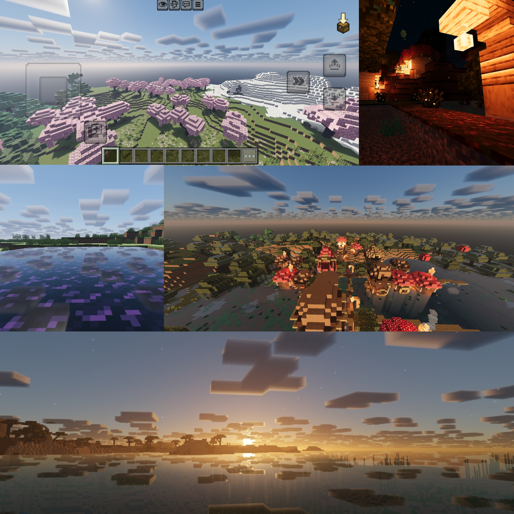

Newb X Origin – RenderDragon Port

A modified RenderDragon port of OriginShader for Minecraft Bedrock Edition.

This project adapts the original OriginShader source to work with the Minecraft Bedrock RenderDragon rendering system.

Credits

Original Shader

OriginShader
Original creator: linlin

Original repository:
https://github.com/bWFuanVzYWth/origin-shader

License: GNU General Public License v3.0 (GPL-3.0)

The original OriginShader code, shader work, and design remain the work of their original author. This project does not claim the original OriginShader work as my own.

RenderDragon Port

Port, adaptation and modifications: Naresh

The RenderDragon port required adapting the shader code and project structure for Minecraft Bedrock's RenderDragon material and shader system.

Build / Compilation

The Newb X MCBE repository was used as part of the build and compilation setup for this project.

Newb X MCBE repository:
https://github.com/devendrn/newb-x-mcbe

Newb X MCBE license: MIT License

Newb X MCBE is credited here for the build/compilation infrastructure used by this project. The Newb repository and the original OriginShader project are separate projects.

Source & Licensing

This project contains modifications based on GPL-3.0 licensed OriginShader code.

The original OriginShader license and applicable copyright notices must be preserved when redistributing or modifying the covered source.

The RenderDragon-specific modifications and porting work are my contribution to this project, while the original OriginShader code remains attributed to its original author.

Please review the included license files for the applicable terms.

Important

- This is a port/modification, not the original OriginShader project.
- Original OriginShader credit is retained.
- Newb X MCBE is credited for its use in the build/compilation setup.
- The original projects are not being presented as my own work.
- Please respect the respective licenses when redistributing or modifying this project.

Project

Project: Newb X Origin
Target: Minecraft Bedrock Edition
Rendering: RenderDragon
Port/Modifications: Naresh

## Dhownload

## Screenshots

